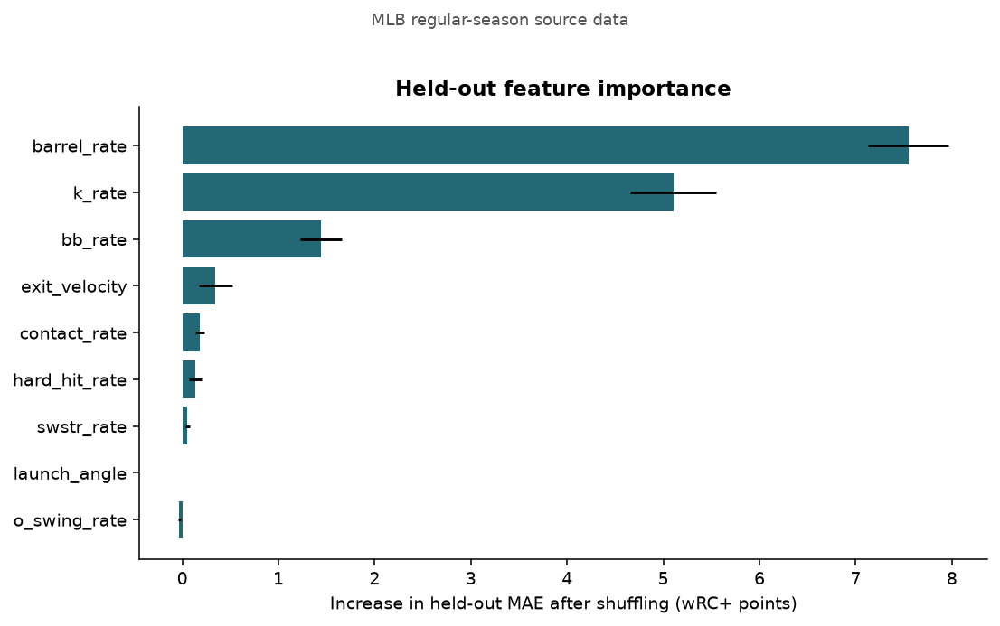
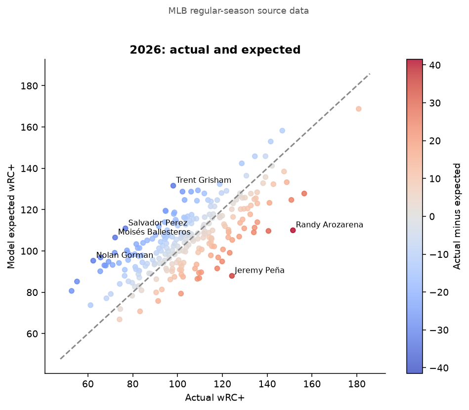
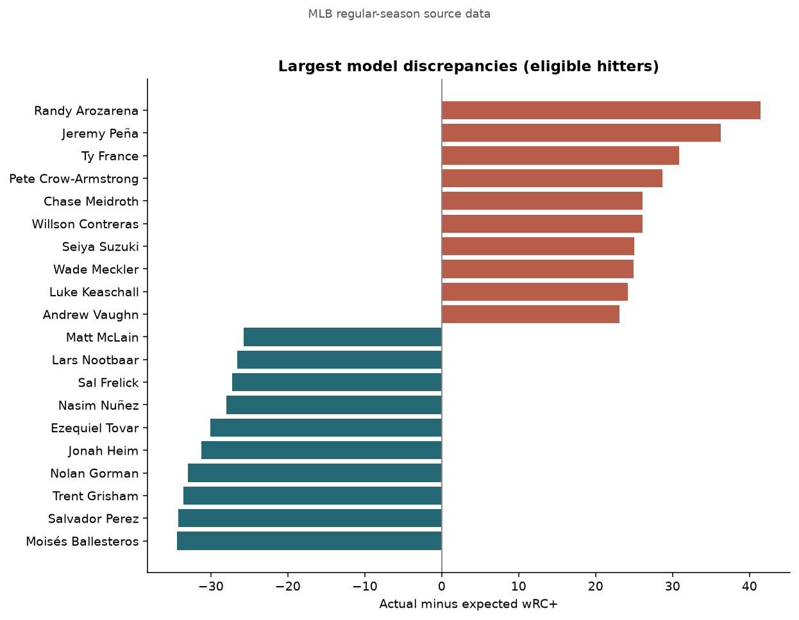
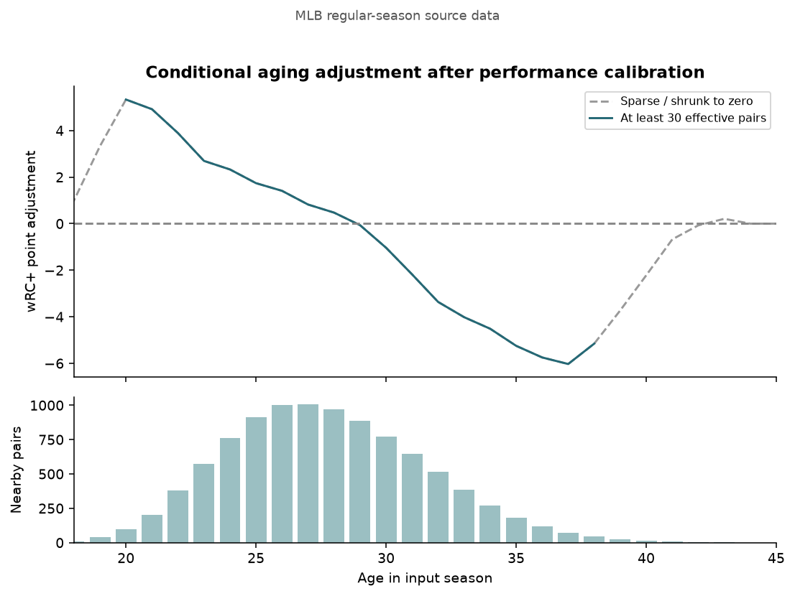
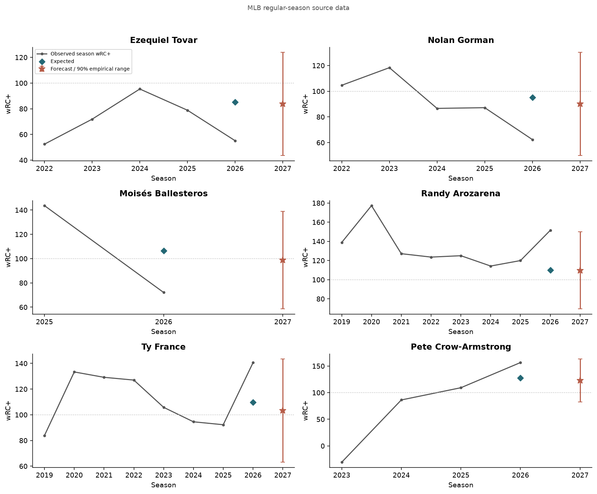

# MLB expected hitting and next-season projections

**Dataset: MLB regular-season source data**

Generated at 2026-10-27T19:17:43.298960+00:00. This project-specific xwRC+ is an XGBoost estimate, not an official MLB or FanGraphs statistic. Same-season estimates and next-season forecasts answer different questions.

## Evaluation

Final historical same-season holdout:

| season | model | mae | rmse | r2 | n |
| --- | --- | --- | --- | --- | --- |
| 2025 | xgboost | 16.13 | 20.98 | 0.46 | 461 |
| 2025 | training_mean | 23.88 | 29.73 | -0.08 | 461 |

Next-season chronological backtests (only earlier target years train each fold):

| target_season | model | mae | rmse | r2 | n | interval_coverage | interval_radius |
| --- | --- | --- | --- | --- | --- | --- | --- |
| 2022 | with_age | 19.46 | 24.87 | 0.24 | 354 | nan | nan |
| 2022 | without_age | 19.55 | 24.95 | 0.23 | 354 | nan | nan |
| 2022 | previous_season | 22.83 | 29.63 | -0.08 | 354 | nan | nan |
| 2022 | recent_history | 21.02 | 27.16 | 0.09 | 354 | nan | nan |
| 2023 | with_age | 18.59 | 23.70 | 0.27 | 353 | 0.90 | 40.02 |
| 2023 | without_age | 18.99 | 24.16 | 0.24 | 353 | nan | nan |
| 2023 | previous_season | 22.95 | 29.28 | -0.12 | 353 | nan | nan |
| 2023 | recent_history | 21.33 | 27.37 | 0.02 | 353 | nan | nan |
| 2024 | with_age | 19.09 | 24.91 | 0.25 | 358 | 0.89 | 40.35 |
| 2024 | without_age | 19.02 | 24.96 | 0.25 | 358 | nan | nan |
| 2024 | previous_season | 23.70 | 30.69 | -0.13 | 358 | nan | nan |
| 2024 | recent_history | 22.05 | 28.79 | 0.00 | 358 | nan | nan |
| 2025 | with_age | 18.38 | 23.60 | 0.29 | 362 | 0.91 | 40.58 |
| 2025 | without_age | 18.50 | 23.76 | 0.28 | 362 | nan | nan |
| 2025 | previous_season | 22.36 | 29.35 | -0.10 | 362 | nan | nan |
| 2025 | recent_history | 20.78 | 27.20 | 0.06 | 362 | nan | nan |

The age-adjusted model should be judged against both the unadjusted calibration and simple history baselines. A worse score is evidence against the adjustment; no improvement is assumed. R-squared can be negative. Metrics describe returning hitters meeting the PA threshold, not everyone on an MLB roster.

In the final 2025 forecast holdout, age-adjusted MAE was 18.38 points, versus 22.36 for previous-season wRC+ and 20.78 for recent history. The age adjustment reduced MAE by 0.12 points relative to calibration without age; a negative reduction means it worsened predictions. Check all folds rather than attributing the full forecasting improvement to aging.

## Candidate signals

Candidates below have at least 300 PA and at most 40% missing selected features. The gap is actual minus expected: positive means above-model performance and negative below-model performance. The 10-point candidate cutoff is a configurable screening rule, not statistical significance. See CSV flags for discrepancies exceeding the historical 90th percentile absolute model error.

Largest below-model 2026 results:

| name | pa | wrc_plus | xwrc | gap_actual_minus_expected |
| --- | --- | --- | --- | --- |
| Moisés Ballesteros | 352.00 | 72.11 | 106.52 | -34.41 |
| Salvador Perez | 627.00 | 76.72 | 110.93 | -34.20 |
| Trent Grisham | 484.00 | 98.06 | 131.59 | -33.53 |
| Nolan Gorman | 302.00 | 62.36 | 95.30 | -32.94 |
| Jonah Heim | 390.00 | 65.64 | 96.87 | -31.23 |
| Ezequiel Tovar | 506.00 | 55.12 | 85.22 | -30.11 |
| Nasim Nuñez | 493.00 | 52.69 | 80.67 | -27.98 |
| Sal Frelick | 384.00 | 71.93 | 99.12 | -27.19 |
| Lars Nootbaar | 334.00 | 102.20 | 128.73 | -26.53 |
| Matt McLain | 496.00 | 67.32 | 93.07 | -25.74 |

Largest above-model 2026 results:

| name | pa | wrc_plus | xwrc | gap_actual_minus_expected |
| --- | --- | --- | --- | --- |
| Randy Arozarena | 670.00 | 151.48 | 110.01 | 41.47 |
| Jeremy Peña | 483.00 | 124.25 | 87.95 | 36.29 |
| Ty France | 500.00 | 140.56 | 109.69 | 30.87 |
| Pete Crow-Armstrong | 726.00 | 156.52 | 127.81 | 28.71 |
| Chase Meidroth | 643.00 | 117.68 | 91.54 | 26.14 |
| Willson Contreras | 535.00 | 150.77 | 124.71 | 26.06 |
| Seiya Suzuki | 634.00 | 134.03 | 109.00 | 25.02 |
| Wade Meckler | 337.00 | 119.88 | 94.92 | 24.96 |
| Luke Keaschall | 620.00 | 123.26 | 99.10 | 24.16 |
| Andrew Vaughn | 331.00 | 134.36 | 111.29 | 23.07 |

Largest projected improvements:

| name | age | pa | wrc_plus | xwrc | forecast | age_adjustment | projected_change | sparse_age_support |
| --- | --- | --- | --- | --- | --- | --- | --- | --- |
| Ezequiel Tovar | 24.00 | 506.00 | 55.12 | 85.22 | 83.75 | 2.33 | 28.63 | False |
| Nolan Gorman | 26.00 | 302.00 | 62.36 | 95.30 | 90.10 | 1.41 | 27.75 | False |
| Moisés Ballesteros | 22.00 | 352.00 | 72.11 | 106.52 | 98.78 | 3.89 | 26.67 | False |
| Jarren Duran | 29.00 | 608.00 | 69.20 | 94.78 | 95.81 | -0.07 | 26.61 | False |
| Sal Frelick | 26.00 | 384.00 | 71.93 | 99.12 | 97.85 | 1.41 | 25.92 | False |
| Cal Raleigh | 29.00 | 530.00 | 94.70 | 119.32 | 118.33 | -0.07 | 23.64 | False |
| Vladimir Guerrero Jr. | 27.00 | 609.00 | 94.59 | 119.50 | 118.17 | 0.82 | 23.58 | False |
| Nasim Nuñez | 25.00 | 493.00 | 52.69 | 80.67 | 75.74 | 1.74 | 23.05 | False |
| Zach McKinstry | 31.00 | 423.00 | 65.49 | 90.18 | 86.91 | -2.18 | 21.42 | False |
| Trent Grisham | 29.00 | 484.00 | 98.06 | 131.59 | 118.46 | -0.07 | 20.40 | False |

Largest projected declines:

| name | age | pa | wrc_plus | xwrc | forecast | age_adjustment | projected_change | sparse_age_support |
| --- | --- | --- | --- | --- | --- | --- | --- | --- |
| Randy Arozarena | 31.00 | 670.00 | 151.48 | 110.01 | 109.71 | -2.18 | -41.77 | False |
| Ty France | 31.00 | 500.00 | 140.56 | 109.69 | 103.26 | -2.18 | -37.30 | False |
| Pete Crow-Armstrong | 24.00 | 726.00 | 156.52 | 127.81 | 123.05 | 2.33 | -33.47 | False |
| Willson Contreras | 34.00 | 535.00 | 150.77 | 124.71 | 117.46 | -4.51 | -33.32 | False |
| Andrew Vaughn | 28.00 | 331.00 | 134.36 | 111.29 | 105.57 | 0.47 | -28.79 | False |
| Josh Jung | 28.00 | 444.00 | 135.59 | 113.92 | 108.32 | 0.47 | -27.26 | False |
| Nolan Arenado | 35.00 | 599.00 | 120.26 | 100.74 | 93.42 | -5.25 | -26.84 | False |
| Jeremy Peña | 28.00 | 483.00 | 124.25 | 87.95 | 98.32 | 0.47 | -25.92 | False |
| Yordan Alvarez | 29.00 | 692.00 | 180.82 | 168.78 | 155.65 | -0.07 | -25.17 | False |
| Seiya Suzuki | 31.00 | 634.00 | 134.03 | 109.00 | 109.24 | -2.18 | -24.79 | False |

## Figures

## Methods and limitations

- Training window: 2016–2025. Chronological expected-performance predictions start after three training seasons. XGBoost parameters are fixed in advance; no holdout tuning is performed. Native missing-value handling avoids global imputation.
- Features are selected from a fixed skills allowlist with at least 70% coverage in each training fold. K and BB rates are mandatory. Target derivatives such as wOBA, OPS, and wRC are excluded. Permutation importance measures association; correlated features can share importance, and repeat standard deviations are not confidence intervals.
- Forecast calibration is a PA-weighted ridge regression using chronological xwRC+, current actual wRC+, and a three-year PA/recency-weighted history. Historical calibration inputs use out-of-time xwRC+, never fitted values. Final calibration only uses target seasons through 2025; 2026 actual outcomes are inputs for 2027, not calibration labels.
- Aging is the smoothed residual next-season change after that calibration, estimated from consecutive seasons with a triangular age kernel (distance <3 years). Harmonic-mean PA weights reduce unreliable pairs; a zero-effect prior of 15,000 PA shrinks sparse ages. This is a conditional observational adjustment, not a causal biological aging curve. It does not add a second age term to an age-aware model.
- Prediction ranges use the finite-sample 90th percentile of absolute earlier out-of-time forecast errors. Coverage is checked only on subsequent years. They are empirical ranges conditional on returning and meeting the PA threshold, with no formal coverage guarantee under distribution shift. They do not predict injuries, playing time, or retirement.
- Discrepancies can reflect omitted skills, park effects, measurement error, and model bias as well as randomness. Large discrepancies do not establish that a hitter was lucky or will regress. Forecast uncertainty is much larger than many player-to-player differences.
- Career charts show observed individual seasons from the downloaded history; historical coverage begins at 2010. No official full-career aggregate wRC+ is reconstructed by averaging yearly indexes.
- Selection of returning players biases age estimates. League changes, tracking changes, and the shortened 2020 season can shift relationships. See sensitivity results below.

## Data audit

| season | players | training_eligible | ranking_pa_eligible | all_contact_features_missing | unmapped_mlbam | bb_rate_missing | k_rate_missing | o_swing_rate_missing | contact_rate_missing | swstr_rate_missing | exit_velocity_missing | launch_angle_missing | barrel_rate_missing | hard_hit_rate_missing |
| --- | --- | --- | --- | --- | --- | --- | --- | --- | --- | --- | --- | --- | --- | --- |
| 2016 | 969 | 438 | 268 | 60 | 0 | 0.00 | 0.00 | 0.02 | 0.01 | 0.00 | 0.08 | 0.08 | 0.06 | 0.06 |
| 2017 | 957 | 435 | 287 | 52 | 0 | 0.00 | 0.00 | 0.02 | 0.01 | 0.00 | 0.07 | 0.07 | 0.05 | 0.06 |
| 2018 | 990 | 448 | 278 | 79 | 0 | 0.00 | 0.00 | 0.03 | 0.01 | 0.00 | 0.10 | 0.10 | 0.08 | 0.08 |
| 2019 | 990 | 451 | 273 | 80 | 0 | 0.00 | 0.00 | 0.01 | 0.02 | 0.00 | 0.10 | 0.10 | 0.08 | 0.08 |
| 2020 | 581 | 310 | 0 | 5 | 0 | 0.00 | 0.00 | 0.00 | 0.01 | 0.00 | 0.01 | 0.01 | 0.01 | 0.01 |
| 2021 | 1049 | 463 | 262 | 104 | 0 | 0.00 | 0.00 | 0.01 | 0.02 | 0.00 | 0.13 | 0.13 | 0.10 | 0.10 |
| 2022 | 693 | 469 | 277 | 8 | 0 | 0.00 | 0.00 | 0.00 | 0.00 | 0.00 | 0.01 | 0.01 | 0.01 | 0.01 |
| 2023 | 656 | 461 | 293 | 5 | 0 | 0.00 | 0.00 | 0.00 | 0.00 | 0.00 | 0.01 | 0.01 | 0.01 | 0.01 |
| 2024 | 651 | 455 | 286 | 4 | 0 | 0.00 | 0.00 | 0.00 | 0.00 | 0.00 | 0.01 | 0.01 | 0.01 | 0.01 |
| 2025 | 673 | 461 | 277 | 7 | 0 | 0.00 | 0.00 | 0.00 | 0.00 | 0.00 | 0.01 | 0.01 | 0.01 | 0.01 |
| 2026 | 662 | 465 | 267 | 110 | 108 | 0.00 | 0.00 | 0.00 | 0.00 | 0.00 | 0.17 | 0.17 | 0.17 | 0.17 |

Source: FanGraphs (pybaseball or documented current-API fallback) + pybaseball/Baseball Savant. Contact join: stable FanGraphs → MLBAM identifiers; unmatched rows retain missing values. Unmatched identifiers remain missing; raw caches and per-download metadata are preserved. The manifest records input hashes and dependency versions. History is not silently treated as a complete career.

## Sensitivity analysis

| scenario | task | mae | rmse | r2 | n |
| --- | --- | --- | --- | --- | --- |
| exclude_2020 | forecast | 18.87 | 24.32 | 0.26 | 1073 |
| exclude_2020_primary_same_rows | forecast | 18.69 | 24.08 | 0.27 | 1073 |
| exclude_2020 | same_season | 16.09 | 20.98 | 0.46 | 461 |
| min_200_pa | forecast | 17.12 | 21.78 | 0.28 | 1071 |
| min_200_pa_primary_same_rows | forecast | 16.66 | 21.18 | 0.32 | 1071 |
| min_200_pa | same_season | 14.06 | 18.07 | 0.49 | 348 |

Sensitivity runs refit the model and calibration with the indicated exclusions/PA thresholds. Compare errors on their reported populations; changing PA thresholds changes the population as well as reliability.

## Sources

- [pybaseball batting data](https://github.com/jldbc/pybaseball/blob/master/docs/batting_stats.md)
- [pybaseball Statcast leaderboards](https://github.com/jldbc/pybaseball/blob/master/docs/statcast_batter.md)
- [FanGraphs wRC+ definition](https://library.fangraphs.com/offense/wrc/)
- [XGBoost API](https://xgboost.readthedocs.io/en/stable/python/python_api.html)
